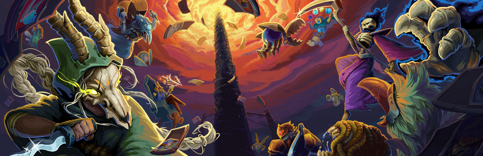

# Slay the Spire 2 Modding Tutorial

Version-aware documentation for building local C# and Godot content mods for **Slay the Spire 2 Early Access**.

Published version: [GitHub Pages](https://fresh-milkshake.github.io/Modding-Tutorial/)

## Coverage

- current game layout, loader behavior, and version checks
- `net9.0` projects referencing the assemblies shipped with the game
- the external mod manifest, dependencies, staging, and installation
- decompiling `sts2.dll` and inspecting `SlayTheSpire2.pck`
- `[ModInitializer]`, semantic hooks, and Harmony patches
- model discovery, pools, unlock visibility, and localization
- detailed custom card, potion, relic, act event, and GUI examples
- Godot `.pck` resources and native UI integration
- logs, save-state troubleshooting, packaging, and release verification

## Verified Baseline

- STS2: `v0.107.1`
- game commit: `59260271`
- tutorial last verified: `2026-11-04`
- target framework: `net9.0`
- bundled .NET runtime: `9.0.7`
- main PCK format: Godot `4.5.1`

Early Access updates can change signatures and loader contracts. Re-check `release_info.json`, `sts2.runtimeconfig.json`, and `sts2.dll` before maintaining a released mod.

## Reading Order

1. [Environment setup](docs/01-environment-setup.md)
2. [Game layout and loader surface](docs/02-vanilla-sts2-layout.md)
3. [Project structure, build, and manifest](docs/03-mod-loading-and-manifests.md)
4. [Reverse-engineering workflow](docs/04-reverse-engineering-the-game.md)
5. [Entry points, Harmony, and hooks](docs/05-entrypoints-harmony-and-hooks.md)
6. [Content infrastructure, assets, and localization](docs/06-assets-pck-and-localization.md)
7. [Native UI and runtime inspection](docs/07-native-ui-and-runtime-inspection.md)
8. [Debugging and iteration](docs/08-debugging-and-fast-iteration.md)
9. [Packaging and verification](docs/09-packaging-installing-and-verifying.md)
10. [Custom cards](docs/10-custom-cards.md)
11. [Custom potions](docs/11-custom-potions.md)
12. [Custom relics](docs/12-custom-relics.md)
13. [Custom act events](docs/13-custom-act-events.md)
14. [Custom GUI](docs/14-custom-gui.md)
15. [State, saves, cloning, and randomness](docs/15-state-saves-and-randomness.md)

Use [docs/handbook-overview.md](docs/handbook-overview.md) as the handbook table of contents. The appendices contain compact API and package references.

## Publishing

Pushes to `main` that change `docs/`, `README.md`, `mkdocs.yml`, the documentation dependencies, or the deployment workflow automatically:

1. run `mkdocs build --strict`
2. publish the generated site to `gh-pages`
3. trigger GitHub Pages deployment from the `gh-pages` branch root

No local MkDocs deployment command is required for a normal release.

## Not Covered

This tutorial does not teach C#, Harmony, Godot, illustration, or game design from first principles. It documents how those tools connect to the current STS2 runtime.

## License

[MIT](LICENSE)
